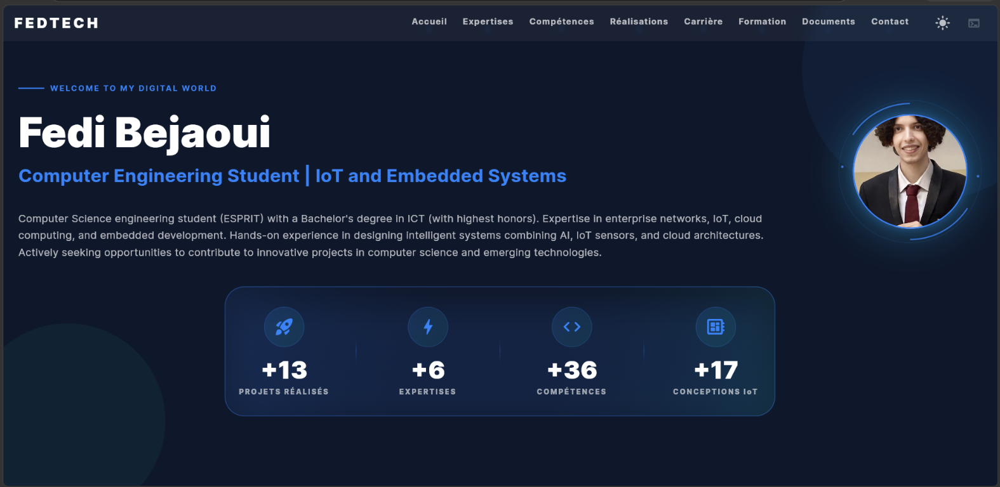
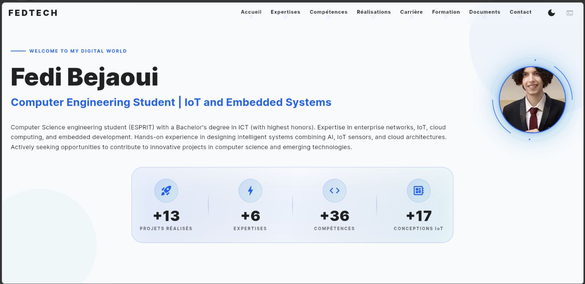
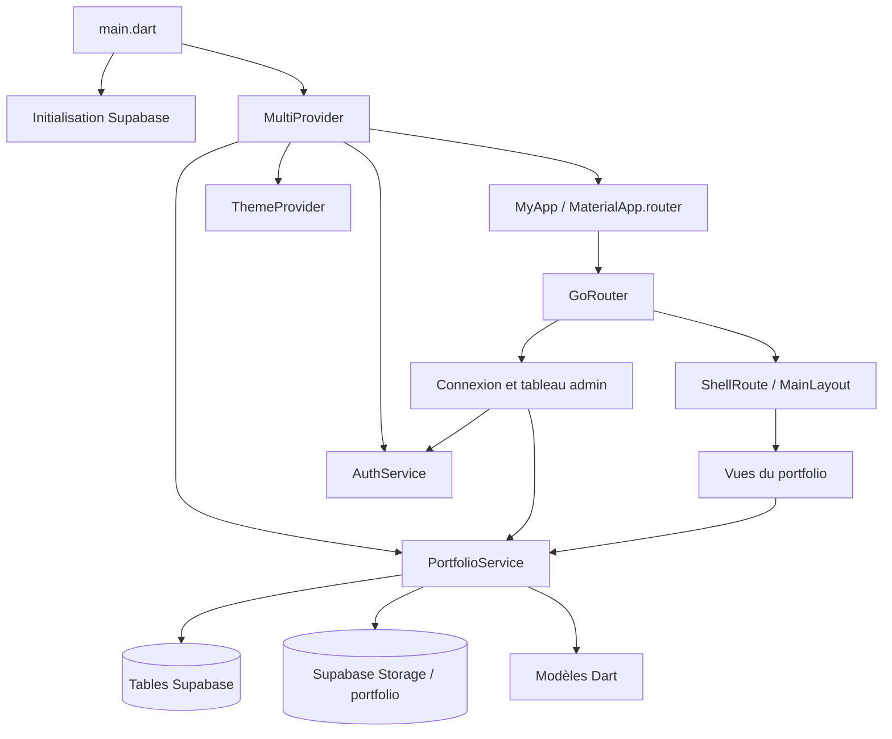

# FedTech — Portfolio personnel

Portfolio web personnel réalisé avec Flutter. Il présente le parcours, les expertises, les compétences et les réalisations de Fedi Bejaoui, avec une interface responsive et un thème clair/sombre.

## Aperçu

### Thème sombre



### Thème clair



## Contenu et fonctionnalités

- Pages dédiées à l’accueil, aux expertises, aux compétences, aux réalisations, à la carrière, à la formation, aux conceptions IoT, aux documents et au contact.
- Présentation du profil et de statistiques sur les projets, expertises, compétences et conceptions IoT.
- Navigation responsive avec transitions animées entre les pages.
- Bascule entre les thèmes clair et sombre.
- Formulaire de contact et espace d’administration pour gérer les contenus du portfolio.
- Chargement des profils, projets, expériences, formations, services, compétences, conceptions IoT et documents depuis Supabase.

## Architecture

L’application est organisée par responsabilités dans `lib/` : `main.dart` initialise Supabase, les providers et le routeur ; les vues décrivent les pages ; les widgets partagés composent la mise en page ; les modèles représentent les données ; et les services gèrent l’accès aux données, l’authentification et le thème.



Les données du profil et des sections sont lues dans Supabase. `PortfolioService` centralise leur chargement et les opérations de gestion, tandis que les fichiers téléversés sont conservés dans le bucket `portfolio`. Les routes publiques sont regroupées dans une mise en page commune ; la route `/admin` affiche la connexion ou le tableau d’administration.

## Technologies

- **Flutter / Dart** pour l’interface web.
- **Provider** pour l’état partagé.
- **GoRouter** pour les routes et les transitions.
- **Supabase** pour les données et le stockage de fichiers.
- **Firebase Hosting** pour l’hébergement du build web.
- **Google Fonts**, **animations**, **flutter_animate**, **intl** et **url_launcher** pour l’interface et ses interactions.

## Exécution locale

Prérequis : Flutter avec le SDK Dart `^3.9.2` et un navigateur compatible.

Copiez `lib/utils/supabase_config.example.dart` vers `lib/utils/supabase_config.dart`, puis renseignez l’URL Supabase et la clé anon de votre projet. Le fichier de configuration personnel est ignoré par Git. Configurez les règles RLS selon les accès nécessaires ; ne placez jamais de clé `service_role` dans l’application.

```bash
flutter pub get
flutter run -d chrome
```

## Déploiement Firebase

Le fichier `firebase.json` publie le contenu de `build/web`.

```bash
flutter build web
firebase deploy
```
